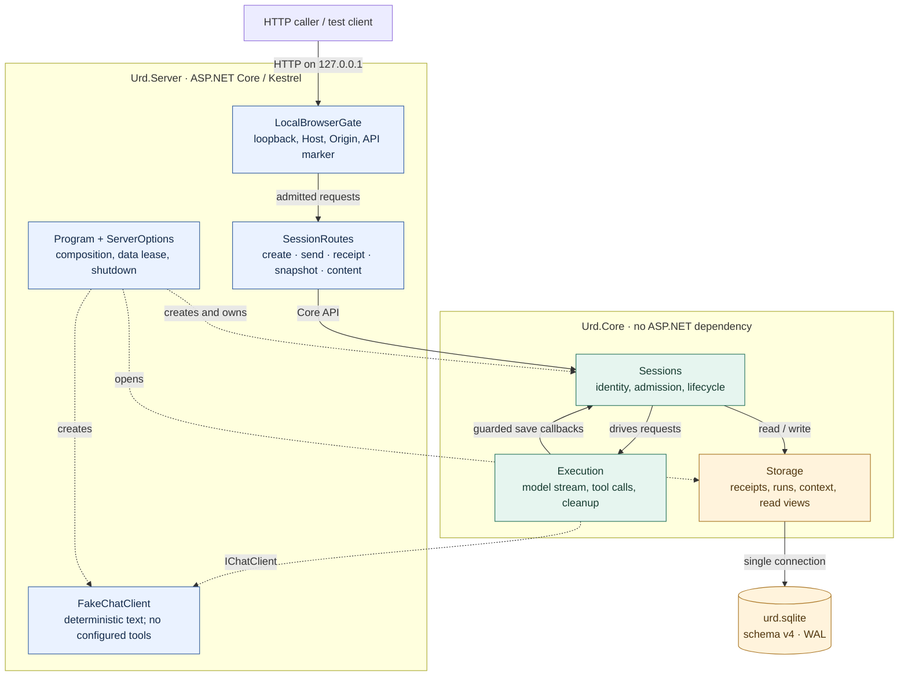
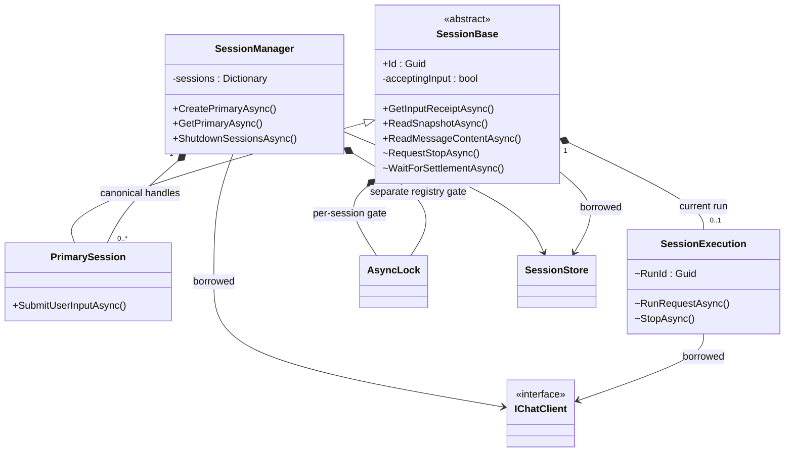
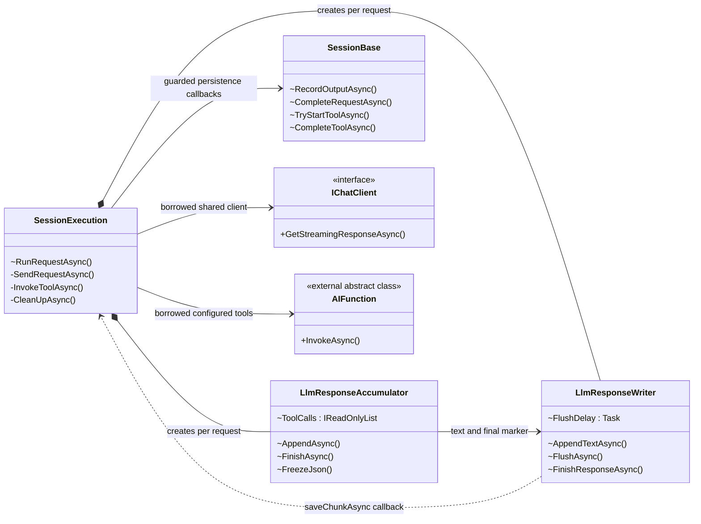
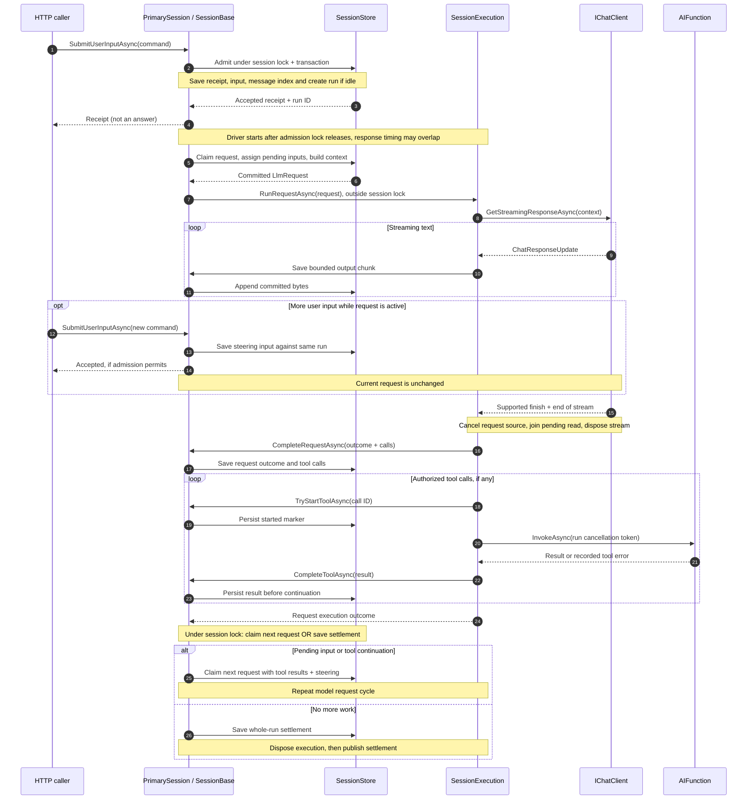
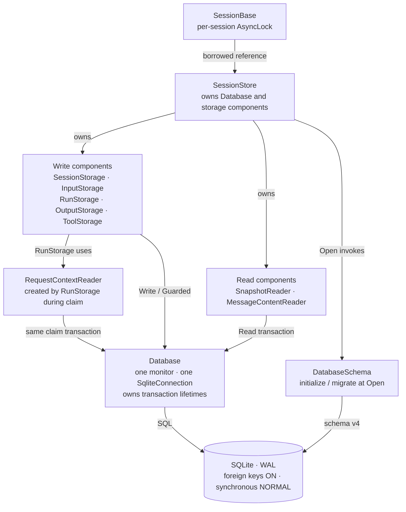
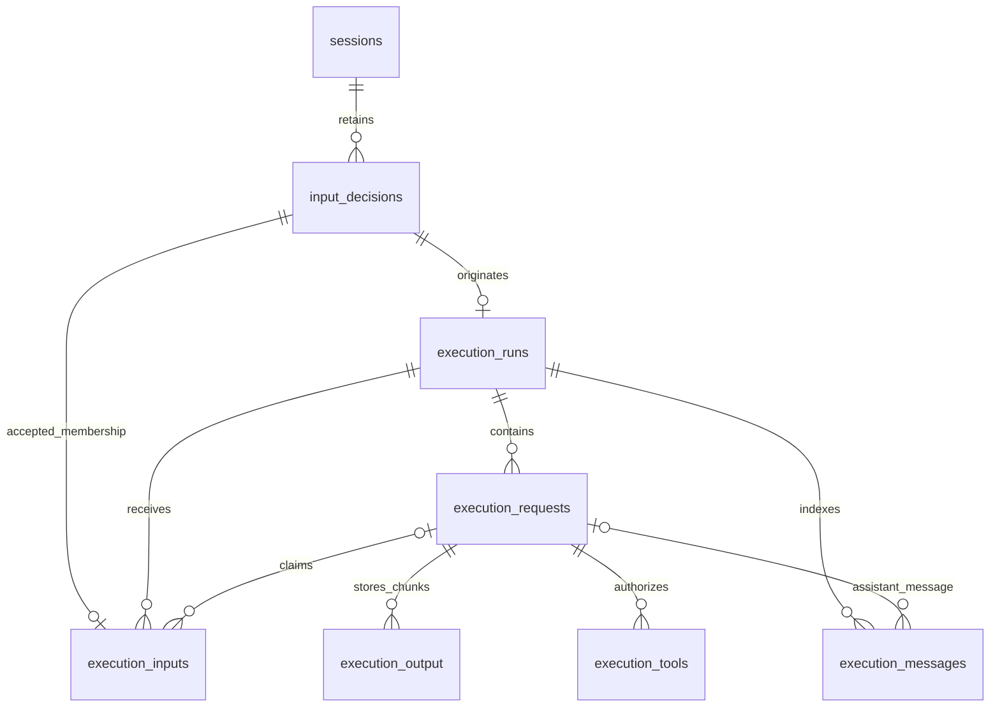
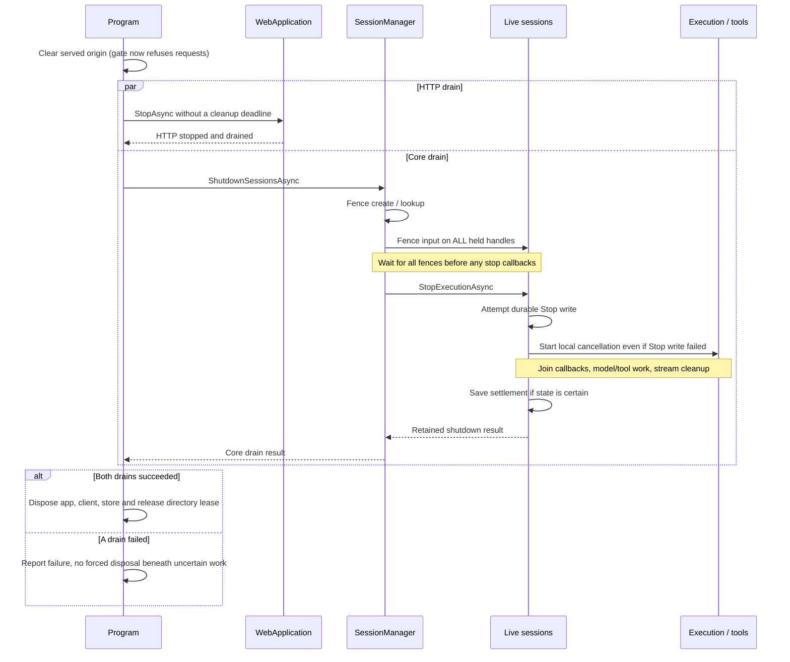

# Urd architecture — visual audit map

> **Working-tree snapshot · 7 November 2026, 08:03 UTC** 
> Base commit: `e5537192e8c8b5f9eea76266c8f8a6726868732f`, **plus uncommitted changes**.
> This describes inspected source, not a new design approval or a runtime qualification.
> Steering, tool execution and schema v4 were in progress at capture time.
> The captured application source subsequently matched commit `732c84f`; tests changed after capture.

[Open the offline visual guide](architecture-map.html) · [Architecture decisions](ARCHITECTURE.md) · [Project direction](../README.md)

## Start here

**Urd currently has two application projects:** a local HTTP Server and an ASP.NET-free Core.
Core owns session identity, input admission, model/tool execution and SQLite persistence.
There is no implemented browser UI or real provider integration in this snapshot.

Read **1 → 2 → 4** for the broad picture. Use **3, 5 and 6** to inspect implementation boundaries;
**7 and 8** explain lifetime guarantees and the most useful review questions.

| Term | Meaning in this code |
| --- | --- |
| Session | A saved conversation plus, when opened, one canonical live handle per manager. |
| Input receipt | The saved decision to accept or refuse one exact input command. Not a model answer. |
| Run | Work started by an accepted input; later steering inputs can join it. At most one unsettled run per session. |
| Request | One model call within a run. A run can contain multiple sequential requests. |
| Settlement | The saved whole-run outcome after owned work and cleanup finish. Not merely the last text chunk. |
| Fence | Refusal of new work when stopping or when ownership/persistence is uncertain. Not automatic recovery. |

**Diagram key:** arrows in overview/flow diagrams are labelled by their meaning. In class diagrams,
`*--` means owned lifetime, `-->` a retained reference, `..>` a dependency and `<|--` inheritance.
`+` denotes public, `~` internal. Members are deliberately selected, not complete API listings.
Method parameters and asynchronous return wrappers are omitted for readability.

## 1. System boundaries

**Read this as:** HTTP adapts commands; Core decides and executes; SQLite retains the facts.
The boxes inside Core are responsibilities in **one assembly**, not separate services.

- The project reference is **`Urd.Server → Urd.Core`**, never the reverse.
- `Program.RunServerAsync` owns the directory lease, store, client, manager and web application.
  It borrows none of them from an external dependency-injection container.
- HTTP disconnects do not cancel admitted work. Receipt/snapshot/content reads do accept request cancellation.
- Only the Server composition uses `FakeChatClient`. Core accepts a borrowed `IChatClient` and optional
  `AIFunction` objects; the tool-capable path is present in Core, not configured by the normal server startup.

**Source:** [Program.cs](../source/hosting/server/Program.cs), [SessionRoutes.cs](../source/hosting/server/SessionRoutes.cs),
[LocalBrowserGate.cs](../source/hosting/server/LocalBrowserGate.cs), [Core project](../source/backend/Urd.Core.csproj),
[Server project](../source/hosting/server/Urd.Server.csproj).

## 2. Session classes and ownership

**Read this as:** the manager keeps identity stable; the session owns the run lifecycle.
A session is not a model request, and neither owns the shared store or client.

| Owner | Keeps / coordinates | Does not own |
| --- | --- | --- |
| `SessionManager` | Canonical handle dictionary; registry lock; shared shutdown outcome; snapshot of configured tool references. | Store/client disposal; model-stream lifetime. |
| `SessionBase` | Session lock; input fence; current execution; driver task and settlement promise. | Provider implementation; direct tool invocation. |
| `PrimarySession` | Public user-input entry point, delegating to base admission. | A second state machine. |
| `SessionExecution` | Run cancellation source; sequential request execution and tool batches. | Session lock; SQL; borrowed client/tool disposal. |

The manager passes the same store, client and configured tool references to its sessions.
The class diagram omits repeated tool-list and client-reference edges for clarity.
`SubagentSession` is a design direction, **not an implemented class** in this snapshot.
Addressed Stop and settlement waiting exist internally, but are not public HTTP operations.

**Source:** [SessionManager.cs](../source/backend/core/sessions/SessionManager.cs),
[SessionBase.cs](../source/backend/core/sessions/SessionBase.cs),
[PrimarySession.cs](../source/backend/core/sessions/PrimarySession.cs),
[AsyncLock.cs](../source/backend/core/sessions/AsyncLock.cs).

## 3. Inside one model request

**Read this as:** execution owns the provider lifetime; accumulation interprets updates;
the writer batches text; the session remains the gateway to storage.

| Record | From → to | Meaning |
| --- | --- | --- |
| `LlmRequest` | `RunStorage` → session → execution | Claimed request ID and reconstructed `ChatMessage` context. |
| `LlmResponseChunk` | writer → execution callback → session → store | Response ID, chunk index, text, final flag. |
| `LlmRequestOutcome` | execution → session → store | Model request outcome plus authorized tool calls; not run settlement. |
| `LlmToolCall` / `LlmToolResult` | accumulator / invocation → store | Frozen JSON arguments/results and explicit call identity. |
| `ExecutionResult` | store → session waiters/read views | Saved whole-run outcome: Completed, Cancelled or Failed. |

The writer saves chunks at **16 KiB** or a **100 ms flush deadline**; this is not an end-to-end latency guarantee.
The accumulator accepts text and complete function-call content, ignores usage content, and requires a supported
finish reason. It is **not a provider-native delta assembler**. Each response permits up to 16 tool calls;
arguments/results are individually bounded to 16 KiB JSON. Tool invocation is sequential within a batch.

**Source:** [SessionExecution.cs](../source/backend/core/execution/SessionExecution.cs),
[LlmResponseAccumulator.cs](../source/backend/core/execution/LlmResponseAccumulator.cs),
[LlmResponseWriter.cs](../source/backend/core/execution/LlmResponseWriter.cs),
[LlmRequest.cs](../source/backend/core/execution/LlmRequest.cs),
[LlmTools.cs](../source/backend/core/execution/LlmTools.cs).

## 4. Send, steering and continuation

**Read this as:** acceptance is durable before execution starts; steering waits for the next request.
This is the successful path, with refusal/retry branches compressed into the notes below.

- An exact retry returns the original receipt without another execution. Reusing an input ID with changed
  contents throws `InputConflictException`. Accepted **and refused** decisions are retained.
- In this WIP snapshot, distinct busy input can join the locally owned run. Admission allows at most
  **8 nonterminal inputs** per run, including inputs already assigned to an unfinished request.
  Stopping, stale revision, capacity and an unowned active run can still cause refusal.
- Pending inputs are claimed together at the next request boundary. Tool results precede the next
  request's newly claimed user messages in reconstructed context. A text-only response can also be
  followed by a new request if steering arrived before settlement.
- Admission and the final pending-work check share the session lock: input cannot slip between the
  check and settlement. An input arriving after settlement starts a new run instead.
- The store rebuilds model context from claimed inputs, saved assistant text, calls and results.
  Visible admission order and model-delivery order are therefore intentionally different views.

**Source:** [InputStorage.cs](../source/backend/core/storage/InputStorage.cs),
[RunStorage.cs](../source/backend/core/storage/RunStorage.cs),
[RequestContextReader.cs](../source/backend/core/storage/RequestContextReader.cs),
[ToolStorage.cs](../source/backend/core/storage/ToolStorage.cs),
[SessionBase.cs](../source/backend/core/sessions/SessionBase.cs).

## 5. Persistence and read boundaries

**Read this as:** several small storage classes share one connection and one database lock.
The grouped operation boxes below are visual groupings, **not additional classes**.

| Operation | Atomic boundary / read budget |
| --- | --- |
| Input admission | Receipt + run association + delivery membership + user-message index in one write transaction. |
| Claim next request | New request + pending-input assignment + context reconstruction in one write transaction. |
| Stream output | Each immutable UTF-8 chunk and its request/message bookkeeping commit together. |
| Complete request | Request outcome, assigned input outcomes and authorized tool-call rows commit together. |
| Tool start / result | Separate durable transactions before and after invocation; external effects are not a SQLite transaction. |
| Snapshot | One committed read view, merged with the live session fence. Up to 60 recent messages, 256 UTF-16 units per preview. |
| Full content page | Up to 16 KiB UTF-8, examining at most 16 segments. Cursor is segment index + byte offset, scalar-safe. |

`SnapshotReader` reuses `MessageContentReader` to make previews. Neither read starts execution.
`HasMore = false` means the current committed tail, not necessarily final output.
`IsClosed`, `FinalOutputCommitted` and saved run settlement answer different questions.
Snapshots expose user/assistant text previews; they are not a complete tool-call/result inspection API.
Older-history navigation is not implemented even though stored context can include older history.

The database lock serializes **all operations through this store**, including reads across different sessions.
WAL does not make this single connection execute parallel queries. Model and tool work run outside session/database
locks, but context reconstruction happens inside the claim transaction and session lock.

**Source:** [SessionStore.cs](../source/backend/core/storage/SessionStore.cs),
[Database.cs](../source/backend/core/storage/Database.cs),
[SnapshotReader.cs](../source/backend/core/storage/SnapshotReader.cs),
[MessageContentReader.cs](../source/backend/core/storage/MessageContentReader.cs),
[Messages.cs](../source/backend/core/sessions/Messages.cs).

## 6. Durable data model

**Read this as:** input decisions, delivery membership, model attempts and run settlement are different facts.
This is a **selected relationship map of effective schema v4**, not the old single-request schema or a full DDL dump.
Crow's foot = many; circle = optional; double bar = exactly one. Lines below represent declared foreign keys;
redundant direct session/run edges are omitted to avoid a tangle.

| Table | Identity / purpose |
| --- | --- |
| `sessions` | `session_id` PK; current history revision. |
| `input_decisions` | `(session_id, input_id)` PK; original command bytes, Accepted/Refused decision and run/refusal data. |
| `execution_runs` | `ordinal` PK, unique `run_id`; originating input, stopping flag and nullable terminal outcome. |
| `execution_inputs` | `ordinal` PK; unique `(session_id, input_id)`; run membership, nullable claimed request and delivery outcome. |
| `execution_requests` | `request_id` PK; unique `(run_id, request_index)`; output identity, final marker and request outcome. |
| `execution_output` | `(request_id, batch_index)` PK; immutable bounded UTF-8 chunks and final flag. |
| `execution_tools` | `(request_id, call_id)` PK; call order/name/arguments, started flag, outcome and saved result/error. |
| `execution_messages` | `ordinal` PK; unique `(run_id, role, message_id)`; ordered user/assistant index for read views. |

**Important constraints and omissions:**

- Partial unique indexes permit at most **one unsettled run per session** and **one unfinished request per run**.
- Every run references its originating input decision through `(session_id, input_id)`;
  steering decisions have membership in that run without originating another run.
- `input_decisions.run_id` is a saved reference **without a declared foreign key**.
  `execution_requests.output_id` likewise is not a foreign key.
- A message row references an input decision for user content **or** a request for assistant content,
  enforced by a role check. The optional input-decision → message edge is omitted from the diagram.
- Other omitted direct FKs: sessions → runs/inputs/messages and runs → tools.
  Separate FKs do not by themselves enforce that all duplicated session/run/request IDs agree;
  application writes preserve that consistency.
- The v4 migration rebuilds requests/output, adds input/message/tool tables and backfills older data atomically.
  Reading only the earlier creation DDL would incorrectly imply one request per run.

**Source:** [DatabaseSchema.cs](../source/backend/core/storage/DatabaseSchema.cs), especially
`EnsureSteeringSchema` for the effective v4 layout.

## 7. Shutdown and the lifetime barrier

**Read this as:** stopping is a request; disposal waits for successful draining.
The host closes HTTP admission before beginning the two drain operations.

A caller cancelling its shutdown wait does not cancel the shared shutdown operation.
Stop callbacks may reenter session reads/admission and are joined outside the session lock.
A cleanup or uncertain persistence failure fences the session rather than silently replaying work.
Reopening a database preserves orphan runs; it does **not** recover them or restart execution.

**Source:** [Program.cs](../source/hosting/server/Program.cs),
[SessionManager.cs](../source/backend/core/sessions/SessionManager.cs),
[SessionBase.cs](../source/backend/core/sessions/SessionBase.cs),
[SessionExecution.cs](../source/backend/core/execution/SessionExecution.cs).

## 8. Where to focus the architecture audit

These are **review questions backed by source**, not a claim that each tradeoff is a bug.
No refactor is proposed or authorized by this guide.

| Priority | Observation | Useful question / next evidence |
| --- | --- | --- |
| First | `RunStorage.ClaimNextRequest` reconstructs all eligible current-revision context through `RequestContextReader`, inside a write transaction and the shared database lock. UI reads are bounded; model context is not comparably bounded. | How does a long conversation affect memory and other sessions' read/write latency? Measure this boundary before adding concurrency machinery or a context cache. |
| First | Cleanup/save uncertainty retains a fenced run; startup has no recovery operation. Tool effects can happen between the durable start marker and saved result. | What explicit recovery or abandonment operation will make a conversation usable again without replaying unknown effects? This is an unfinished product path, not a reason to weaken fencing. |
| Next | `SessionBase` coordinates admission, request progression, persistence callbacks, cancellation and settlement. `SessionExecution` calls back into it. | Can these lifetimes still be understood locally as capabilities grow? Preserve one lifecycle owner; split only responsibilities with a genuinely independent lifetime. |
| Next | `SessionManager` keeps every opened handle; there is no eviction/close path. Client and tool instances are shared across sessions. | What is the measured cost of many idle handles, and do real clients/tools support concurrent sessions? Do not infer resource safety from the fake client alone. |
| Next | Delivery order differs from visible message order; tool facts are saved but not fully exposed by the current text read surface. | What should the first UI show about pending steering, tool activity and uncertain effects? A receipt or final text marker must not masquerade as completed work. |

### Present versus planned

| Present in inspected source | Not implemented / not qualified by this map |
| --- | --- |
| Two-project Server → Core dependency; local HTTP gate and five session operations. | Browser UI, desktop/VS Code hosts, LAN/Tailscale access. |
| Canonical primary sessions; durable receipts; committed snapshot/content reads; shutdown fencing. | `SubagentSession`, assignments, wakeups, session listing, public addressed Stop, startup recovery. |
| WIP steering, multiple requests per run, sequential configured tool invocation and schema v4. | Real provider adapters, native streaming/tool fidelity, normal-server tool configuration, a complete explicit follow-up queue policy. |
| Bounded text batching and bounded read pages. | Bounded/compacted model context, long-session/fan-out performance qualification. |
| Shared `IChatClient` abstraction and SQLite implementation. | MCP integration, guidance loading, usage accounting and the wider planned harness. |

### Evidence and maintenance

This map was checked against a frozen copy of the working tree, including untracked source files.
The application source was compared with the subsequent `732c84f` checkpoint and matched; three test/support
files changed after capture. The [backend verification record](backend-development.md) was subsequently updated
in `4ea3d1f` to report 259 passing Release tests for that checkpoint. This map does not independently rerun them.
Consult the [backend](backend-development.md), [server](server-development.md) and design records for scoped
approvals, verification and implementation limits. Older statements that steering/tools are absent describe
previous checkpoints, not this source snapshot. Source links above point to the **live checkout** and can move.

No application code, application data or existing working-tree edits were changed for this guide.
Validation covers diagram rendering, document links and independent source-to-diagram review;
application builds/tests and live-provider/performance validation are not claimed.

This Markdown is the editable diagram source (Mermaid). The HTML companion is a static, offline rendering
of the same snapshot, with embedded SVGs, navigation and printable layout; it makes no network requests.
It is not live-generated from C#. When updating the map, recheck ownership, cardinalities and transaction
boundaries against source, update the snapshot label, render the Mermaid blocks again, and regenerate
both views together. Mermaid **11.12.2** was used for this rendering.
