# Urd — complete production class atlas

> **Historical snapshot — superseded for current naming and structure.** See
> [Backend development](backend-development.md) and [Server development](server-development.md) for current contracts.
> Diagrams, counts and historical locations retain the captured state; source links point to current replacements.
> `StoredSessionSnapshot` has since merged into `SessionSnapshot`, the private `Settlement` is a named tuple,
> and shared `JsonText` validation now lives in `StorageText`.

**28 classes · 20 records · 5 enums · 1 struct = 54 declared types, all shown below.**
This is the complete first-party production type inventory, not just the four session classes.
Records are counted separately from ordinary `class` declarations; all 20 are record classes.

[Open the visual class atlas](class-map.html) · [System and flow overview](architecture-map.html) · [Architecture decisions](ARCHITECTURE.md)

> **Snapshot: 7 November 2026, 08:54 UTC.** Base commit `832102c` plus working-tree changes,
> including the in-progress public Stop surface. Captured from 35 C# files under
> `source/backend` and `source/hosting`. Tests, generated code and third-party library internals are excluded.
> This is a source map, not a claim that the captured changes have passed runtime qualification.
> The linked system/flow overview is an earlier, separately dated snapshot.

**Coverage is exhaustive for types; members and relationships are selected.** Every declared type has an
explicit diagram box and a source entry in the index. Cross-component types recur where useful; repeats
are the same type, not extra classes. Seven nested types are included, not hidden in their owning files.
`SubagentSession`, provider adapters, MCP and UI classes are not drawn because they do not exist in this snapshot.

**Key:** `*--` owned lifetime; `-->` retained reference or typed data member; `..>` dependency/creation;
`<|--` inheritance; `..|>` interface implementation. `+` public, `~` internal, `-` private.
Parameter lists and async return wrappers are abbreviated. External types are explicitly marked and
are not included in the 54-type total. Source links resolve to the live checkout, which may subsequently change.

## 1. Hosting and HTTP

Four classes compose and expose the backend. `ServerOptions` and the nested content-query record support them.

### Host composition

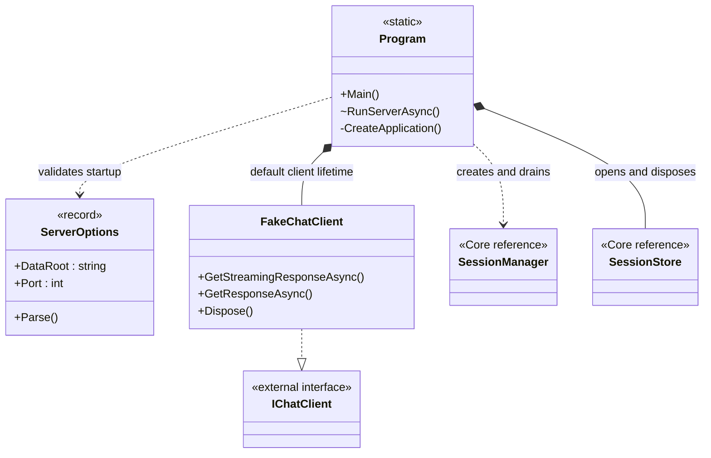

`Program.RunServerAsync` owns the app, directory lease, store and created client. Its composition arrows
represent a **server-run lifetime**, not instance fields on the static class. Core borrows the store/client.
The normal server uses `FakeChatClient`; its client-factory overload is a composition seam for tests.
Disposal follows successful HTTP and Core draining, not client disconnection.

### HTTP boundary

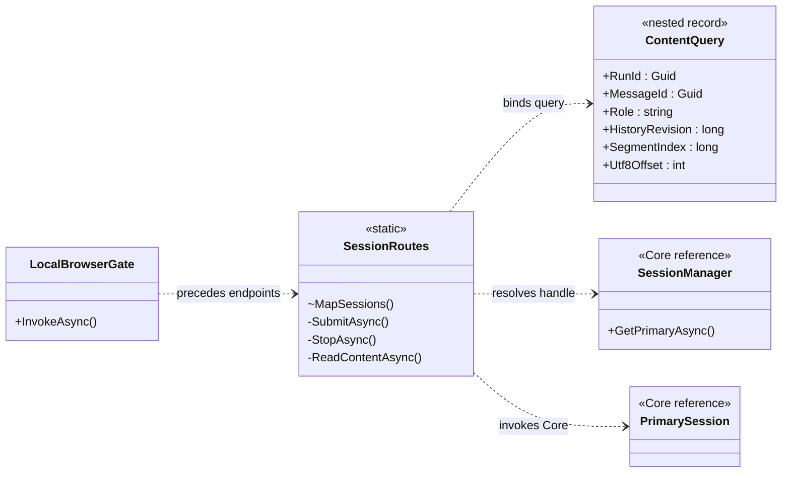

`LocalBrowserGate` admits requests by readiness, loopback, Host, Origin and the API marker; its edge is
**pipeline order**, not a direct reference to `SessionRoutes`. `SessionRoutes.ContentQuery` is private and
nested. Routes translate HTTP without owning execution policy. Reads accept request cancellation;
admitted input and Stop intent do not belong to the HTTP connection's lifetime.

**Source:** [Program](../source/hosting/server/Program.cs), [ServerOptions](../source/hosting/server/ServerOptions.cs),
[FakeChatClient](../source/hosting/server/FakeChatClient.cs), [LocalBrowserGate](../source/hosting/server/LocalBrowserGate.cs),
[SessionRoutes](../source/hosting/server/SessionRoutes.cs).

## 2. Sessions, input and Stop

The manager owns canonical handles; each session coordinates its own state and run. Shared dependencies
and data contracts are shown separately so they do not obscure this ownership structure.

### Session lifetime and locks

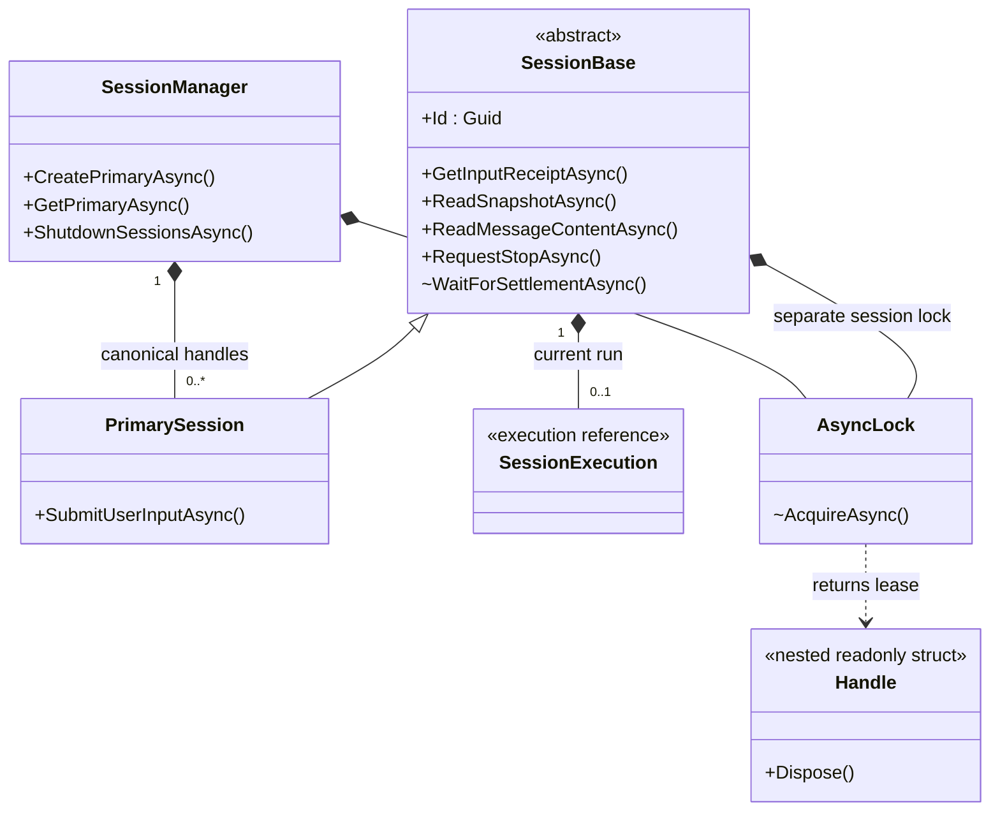

The two lock edges name the **same type but separate instances**. `AsyncLock.Handle` releases its acquired
semaphore on disposal. `SessionManager` and sessions borrow `SessionStore` and `IChatClient`; the manager
snapshots configured tool references and passes them along, without taking ownership of tool disposal.
Model/tool work and cancellation callbacks run outside the session lock; guarded storage calls enter it.

### Identity and input contracts

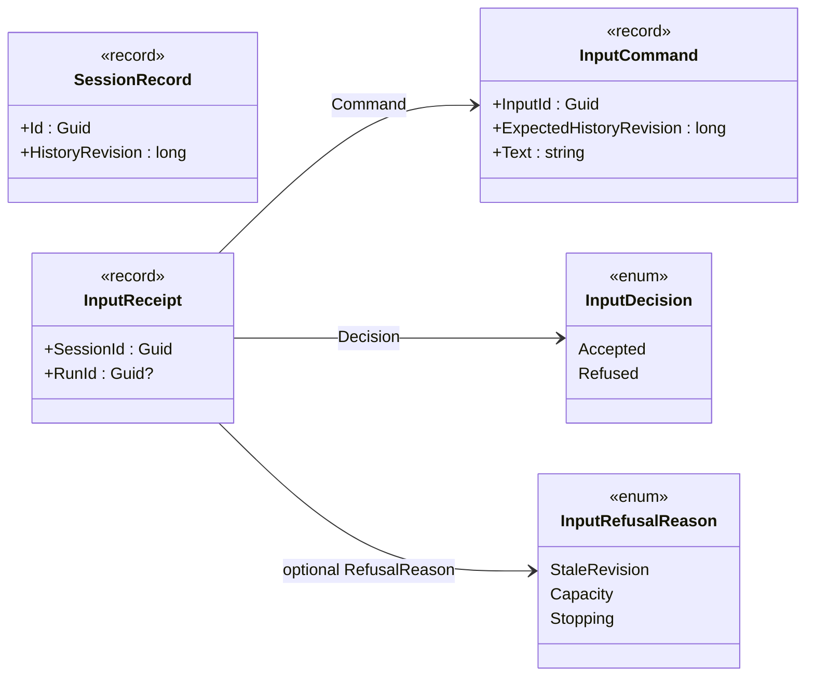

`SessionRecord` is the store-to-manager identity value used to construct a handle. An `InputReceipt` retains
the exact command and its original decision. Acceptance links it to a run; it is not a model answer.

### Stop acknowledgement versus run settlement

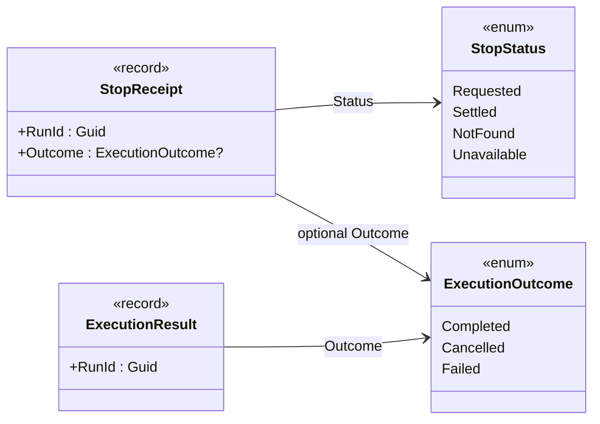

In this newer snapshot `SessionBase.RequestStopAsync` is public and returns `StopReceipt`.
For an owned run, it signals cancellation and attempts to save Stop intent; it does not wait for cleanup.
`ExecutionResult` is published after owned work, cleanup and saved settlement. Do not read `Requested` as
`Settled`. No subagent/descendant runtime is implemented here; this map does not qualify descendant Stop
behavior or imply that stopping one run stops separate independent worker chats.

**Source:** [SessionManager](../source/backend/core/sessions/SessionManager.cs),
[SessionBase](../source/backend/core/sessions/SessionBase.cs), [PrimarySession](../source/backend/core/sessions/PrimarySession.cs),
[AsyncLock and Handle](../source/backend/core/sessions/AsyncLock.cs), [SessionRecord](../source/backend/core/sessions/SessionRecord.cs),
[Input contracts](../source/backend/core/sessions/UserMessageSubmission.cs), [Stop contracts](../source/backend/core/sessions/Stop.cs),
[ExecutionResult and outcome](../source/backend/core/execution/SessionExecutionResult.cs).

## 3. Execution and model data

Execution owns the model/tool work lifetime, accumulation interprets updates, and the writer batches text.
Private error classes are included in section 6, rather than omitted from the atlas.

### Execution collaborators

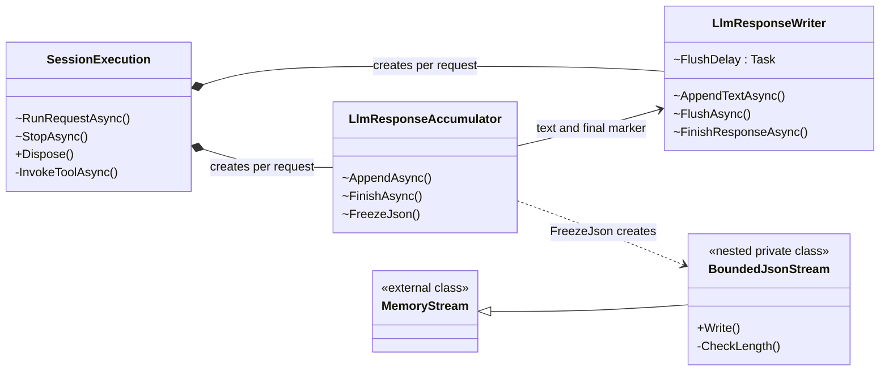

`LlmResponseAccumulator.BoundedJsonStream` enforces the tool-JSON size limit while freezing borrowed values.
`SessionExecution` borrows `IChatClient`, `AIFunction` objects and its `SessionBase`; persistence callbacks
return through that session's guard. The writer's save callback returns through execution to the session.
These shared boundary edges are described here, not misrepresented as owned dependencies in the diagram.

### Model requests, chunks and tools

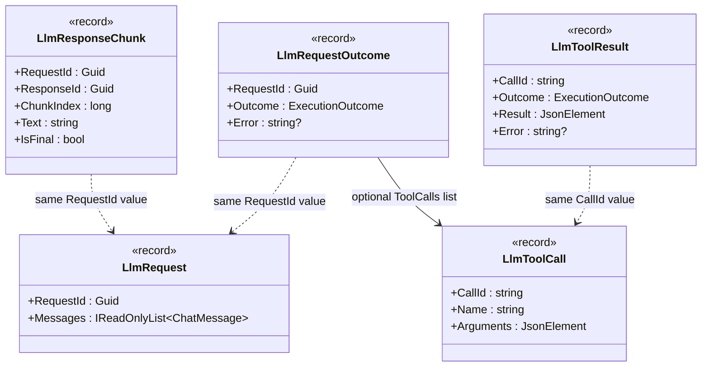

The dotted ID links are **value correlations**, not object references. `ChatMessage` and `JsonElement`
are external types. The request data is prepared by storage before the model call; output chunks and
request outcomes travel back through the session. A final text chunk is not whole-run settlement.
The accumulator supports complete fake-model calls, not qualified provider-native deltas.

**Source:** [SessionExecution](../source/backend/core/execution/SessionExecution.cs),
[LlmResponseAccumulator](../source/backend/core/execution/LlmResponseAccumulator.cs),
[LlmResponseWriter](../source/backend/core/execution/LlmResponseWriter.cs),
[Request/chunk/outcome records](../source/backend/core/execution/LlmRequest.cs),
[Tool records](../source/backend/core/execution/LlmTools.cs).

## 4. Storage classes

All twelve storage classes appear here. They share a single `Database`; the helpers do not each open their
own connection. The private settlement and message-metadata records are included too.

### Store, database and identity

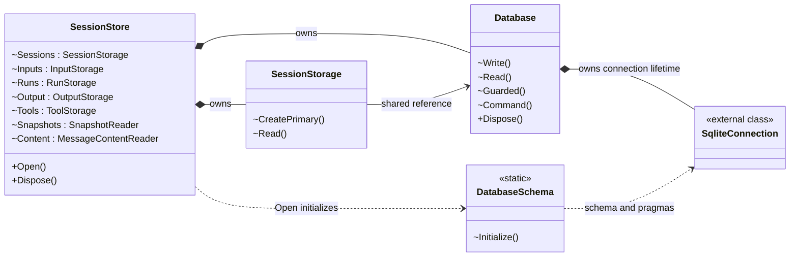

`SessionStore` also owns the write/read helpers in the next two views; its property list makes those
connections explicit without repeating every line. `Database` serializes all access to its connection
and owns transaction lifetimes. `DatabaseSchema` initializes/migrates schema v4 and connection pragmas.

### Durable writes

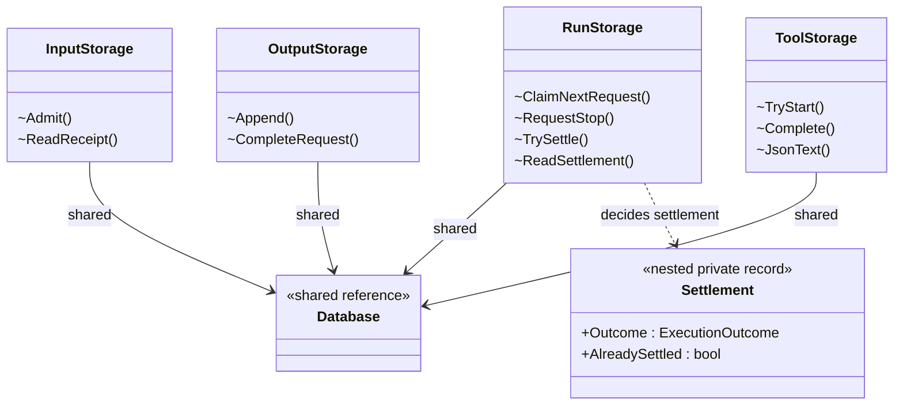

`InputStorage` keeps exact admission decisions and delivery membership. `RunStorage` claims requests,
records Stop status and settles runs; `RunStorage.Settlement` is its private decision value.
`OutputStorage` saves immutable chunks and completed request/tool-call facts. `ToolStorage` saves
start markers and results around external invocation; a database transaction does not roll back tool effects.
`RunStorage` creates `RequestContextReader` during a claim, inside that same write transaction.

### Readers, context and text

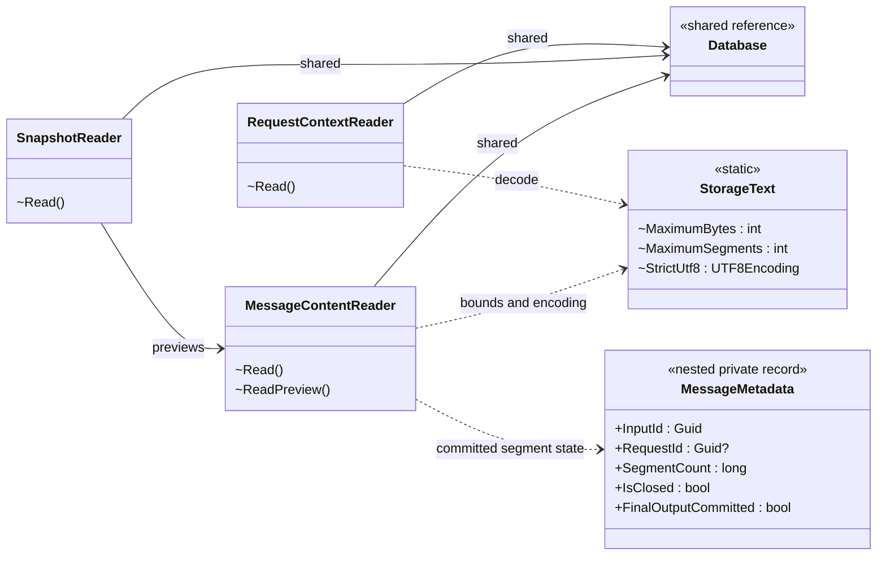

`SnapshotReader` reuses `MessageContentReader` in one snapshot read transaction. The private
`MessageContentReader.MessageMetadata` describes committed segments, not a second message store.
`RequestContextReader` assembles model context within the claim transaction. Read pages are bounded;
context assembly is not similarly bounded, and holds the shared connection lock.

**Source:** [SessionStore](../source/backend/core/storage/SessionStore.cs), [Database](../source/backend/core/storage/Database.cs),
[DatabaseSchema](../source/backend/core/storage/DatabaseSchema.cs), [SessionStorage](../source/backend/core/storage/SessionStorage.cs),
[InputStorage](../source/backend/core/storage/UserMessageStorage.cs), [RunStorage](../source/backend/core/storage/SessionExecutionStorage.cs),
[OutputStorage](../source/backend/core/storage/LlmResponseStorage.cs), [ToolStorage](../source/backend/core/storage/ToolStorage.cs),
[RequestContextReader](../source/backend/core/storage/LlmContextReader.cs), [SnapshotReader](../source/backend/core/storage/SnapshotReader.cs),
[MessageContentReader](../source/backend/core/storage/MessageContentReader.cs), [StorageText](../source/backend/core/storage/StorageText.cs).

## 5. Snapshot and content records

These are detached read values, not live sessions. Listing them separately keeps the runtime diagrams
readable without pretending the data model does not exist.

### Snapshot views

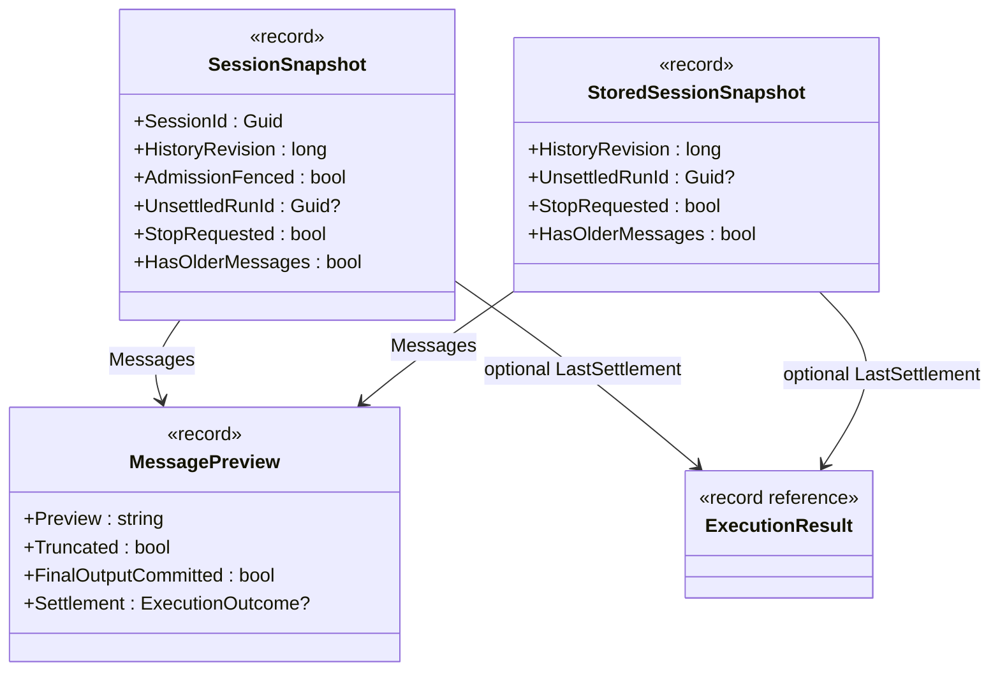

`SessionBase` merges the stored snapshot with its live admission fence and local stopping state.
The public snapshot is therefore not just a renamed storage record. Both carry bounded message previews
and independently selected run/settlement facts.

### Message identity and paging

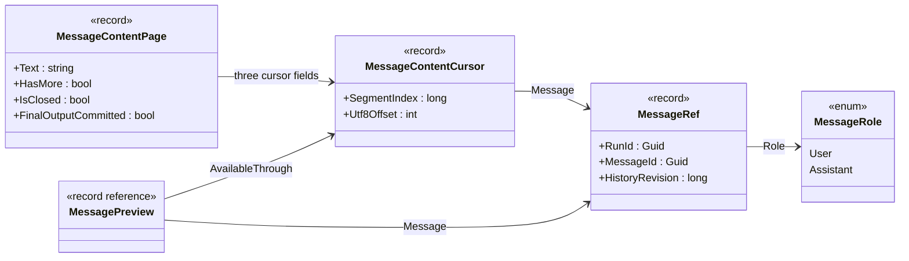

The page's three cursor fields are `From`, `Next` and `AvailableThrough`.
Offsets are UTF-8 bytes inside a segment. `HasMore` describes the current committed tail; `IsClosed`
describes whether more message bytes can arrive. Neither substitutes for saved run settlement.

**Source:** [SessionSnapshot](../source/backend/core/sessions/SessionSnapshot.cs),
[StoredSessionSnapshot (now merged into SessionSnapshot)](../source/backend/core/sessions/SessionSnapshot.cs),
[Message records and role](../source/backend/core/sessions/Messages.cs).

## 6. Error classes and private execution signals

These four classes are easy to miss in an overview. Two are public Core exceptions; two are private
nested execution signals. Their different roles are preserved rather than folded into a generic error box.

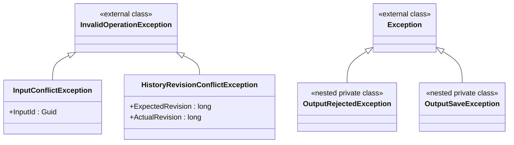

- `InputConflictException`: an input ID was reused with a different original command.
- `HistoryRevisionConflictException`: a content read targets a revision that is no longer current.
- `SessionExecution.OutputRejectedException`: the current run no longer accepts that output.
- `SessionExecution.OutputSaveException`: saving output failed; this is not an ordinary model failure.

The other nested helpers are explicitly drawn with their users: `AsyncLock.Handle` in section 2,
`LlmResponseAccumulator.BoundedJsonStream` in section 3, `RunStorage.Settlement` and
`MessageContentReader.MessageMetadata` in section 4, and `SessionRoutes.ContentQuery` in section 1.

**Source:** [InputConflictException](../source/backend/core/sessions/UserMessageConflictException.cs),
[HistoryRevisionConflictException](../source/backend/core/sessions/HistoryRevisionConflictException.cs),
[Execution signals](../source/backend/core/execution/SessionExecution.cs).

## 7. Complete type index

Every one of the 54 source declarations has a diagram and a source entry. Nested names include their owner;
source line numbers refer to the captured snapshot. Referenced external types and repeated boxes are not counted.

| Type | Kind | Source (snapshot line) |
| --- | --- | --- |
| [ExecutionOutcome](#stop-acknowledgement-versus-run-settlement) | enum | [ExecutionResult.cs:9](../source/backend/core/execution/SessionExecutionResult.cs) |
| [ExecutionResult](#stop-acknowledgement-versus-run-settlement) | record | [ExecutionResult.cs:4](../source/backend/core/execution/SessionExecutionResult.cs) |
| [LlmRequest](#model-requests-chunks-and-tools) | record | [LlmRequest.cs:7](../source/backend/core/execution/LlmRequest.cs) |
| [LlmRequestOutcome](#model-requests-chunks-and-tools) | record | [LlmRequest.cs:22](../source/backend/core/execution/LlmRequest.cs) |
| [LlmResponseAccumulator](#execution-collaborators) | class | [LlmResponseAccumulator.cs:7](../source/backend/core/execution/LlmResponseAccumulator.cs) |
| [LlmResponseAccumulator.BoundedJsonStream](#execution-collaborators) | nested class | [LlmResponseAccumulator.cs:78](../source/backend/core/execution/LlmResponseAccumulator.cs) |
| [LlmResponseChunk](#model-requests-chunks-and-tools) | record | [LlmRequest.cs:13](../source/backend/core/execution/LlmRequest.cs) |
| [LlmResponseWriter](#execution-collaborators) | class | [LlmResponseWriter.cs:7](../source/backend/core/execution/LlmResponseWriter.cs) |
| [LlmToolCall](#model-requests-chunks-and-tools) | record | [LlmTools.cs:6](../source/backend/core/execution/LlmTools.cs) |
| [LlmToolResult](#model-requests-chunks-and-tools) | record | [LlmTools.cs:9](../source/backend/core/execution/LlmTools.cs) |
| [SessionExecution](#execution-collaborators) | class | [SessionExecution.cs:9](../source/backend/core/execution/SessionExecution.cs) |
| [SessionExecution.OutputRejectedException](#6-error-classes-and-private-execution-signals) | nested class | [SessionExecution.cs:199](../source/backend/core/execution/SessionExecution.cs) |
| [SessionExecution.OutputSaveException](#6-error-classes-and-private-execution-signals) | nested class | [SessionExecution.cs:201](../source/backend/core/execution/SessionExecution.cs) |
| [AsyncLock](#session-lifetime-and-locks) | class | [AsyncLock.cs:8](../source/backend/core/sessions/AsyncLock.cs) |
| [AsyncLock.Handle](#session-lifetime-and-locks) | nested struct | [AsyncLock.cs:16](../source/backend/core/sessions/AsyncLock.cs) |
| [HistoryRevisionConflictException](#6-error-classes-and-private-execution-signals) | class | [HistoryRevisionConflictException.cs:4](../source/backend/core/sessions/HistoryRevisionConflictException.cs) |
| [InputCommand](#identity-and-input-contracts) | record | [Input.cs:4](../source/backend/core/sessions/UserMessageSubmission.cs) |
| [InputConflictException](#6-error-classes-and-private-execution-signals) | class | [InputConflictException.cs:4](../source/backend/core/sessions/UserMessageConflictException.cs) |
| [InputDecision](#identity-and-input-contracts) | enum | [Input.cs:16](../source/backend/core/sessions/UserMessageSubmission.cs) |
| [InputReceipt](#identity-and-input-contracts) | record | [Input.cs:8](../source/backend/core/sessions/UserMessageSubmission.cs) |
| [InputRefusalReason](#identity-and-input-contracts) | enum | [Input.cs:22](../source/backend/core/sessions/UserMessageSubmission.cs) |
| [MessageContentCursor](#message-identity-and-paging) | record | [Messages.cs:19](../source/backend/core/sessions/Messages.cs) |
| [MessageContentPage](#message-identity-and-paging) | record | [Messages.cs:23](../source/backend/core/sessions/Messages.cs) |
| [MessagePreview](#message-identity-and-paging) | record | [Messages.cs:13](../source/backend/core/sessions/Messages.cs) |
| [MessageRef](#message-identity-and-paging) | record | [Messages.cs:6](../source/backend/core/sessions/Messages.cs) |
| [MessageRole](#message-identity-and-paging) | enum | [Messages.cs:10](../source/backend/core/sessions/Messages.cs) |
| [PrimarySession](#session-lifetime-and-locks) | class | [PrimarySession.cs:7](../source/backend/core/sessions/PrimarySession.cs) |
| [SessionBase](#session-lifetime-and-locks) | class | [SessionBase.cs:10](../source/backend/core/sessions/SessionBase.cs) |
| [SessionManager](#session-lifetime-and-locks) | class | [SessionManager.cs:7](../source/backend/core/sessions/SessionManager.cs) |
| [SessionRecord](#identity-and-input-contracts) | record | [SessionRecord.cs:4](../source/backend/core/sessions/SessionRecord.cs) |
| [SessionSnapshot](#snapshot-views) | record | [SessionSnapshot.cs:6](../source/backend/core/sessions/SessionSnapshot.cs) |
| [StopReceipt](#stop-acknowledgement-versus-run-settlement) | record | [Stop.cs:6](../source/backend/core/sessions/Stop.cs) |
| [StopStatus](#stop-acknowledgement-versus-run-settlement) | enum | [Stop.cs:8](../source/backend/core/sessions/Stop.cs) |
| [Database](#store-database-and-identity) | class | [Database.cs:6](../source/backend/core/storage/Database.cs) |
| [DatabaseSchema](#store-database-and-identity) | class | [DatabaseSchema.cs:6](../source/backend/core/storage/DatabaseSchema.cs) |
| [InputStorage](#durable-writes) | class | [InputStorage.cs:7](../source/backend/core/storage/UserMessageStorage.cs) |
| [MessageContentReader](#readers-context-and-text) | class | [MessageContentReader.cs:9](../source/backend/core/storage/MessageContentReader.cs) |
| [MessageContentReader.MessageMetadata](#readers-context-and-text) | nested record | [MessageContentReader.cs:215](../source/backend/core/storage/MessageContentReader.cs) |
| [OutputStorage](#durable-writes) | class | [OutputStorage.cs:7](../source/backend/core/storage/LlmResponseStorage.cs) |
| [RequestContextReader](#readers-context-and-text) | class | [RequestContextReader.cs:10](../source/backend/core/storage/LlmContextReader.cs) |
| [RunStorage](#durable-writes) | class | [RunStorage.cs:8](../source/backend/core/storage/SessionExecutionStorage.cs) |
| [RunStorage.Settlement](#durable-writes) | nested record (replaced by tuple) | [Current SessionExecutionStorage.cs](../source/backend/core/storage/SessionExecutionStorage.cs) |
| [SessionStorage](#store-database-and-identity) | class | [SessionStorage.cs:7](../source/backend/core/storage/SessionStorage.cs) |
| [SessionStore](#store-database-and-identity) | class | [SessionStore.cs:6](../source/backend/core/storage/SessionStore.cs) |
| [SnapshotReader](#readers-context-and-text) | class | [SnapshotReader.cs:10](../source/backend/core/storage/SnapshotReader.cs) |
| [StorageText](#readers-context-and-text) | class | [StorageText.cs:6](../source/backend/core/storage/StorageText.cs) |
| [StoredSessionSnapshot](#snapshot-views) | record (merged into SessionSnapshot) | [Current SessionSnapshot.cs](../source/backend/core/sessions/SessionSnapshot.cs) |
| [ToolStorage](#durable-writes) | class | [ToolStorage.cs:8](../source/backend/core/storage/ToolStorage.cs) |
| [FakeChatClient](#host-composition) | class | [FakeChatClient.cs:7](../source/hosting/server/FakeChatClient.cs) |
| [LocalBrowserGate](#http-boundary) | class | [LocalBrowserGate.cs:7](../source/hosting/server/LocalBrowserGate.cs) |
| [Program](#host-composition) | class | [Program.cs:17](../source/hosting/server/Program.cs) |
| [ServerOptions](#host-composition) | record | [ServerOptions.cs:6](../source/hosting/server/ServerOptions.cs) |
| [SessionRoutes](#http-boundary) | class | [SessionRoutes.cs:11](../source/hosting/server/SessionRoutes.cs) |
| [SessionRoutes.ContentQuery](#http-boundary) | nested record | [SessionRoutes.cs:195](../source/hosting/server/SessionRoutes.cs) |

### Verification and maintenance

The inventory was checked against the frozen production source declarations, including primary constructors,
semicolon-only exception classes and all nested types. Coverage checks require every inventory name to have
an explicit Mermaid class declaration and an index row. Diagrams were rendered and reviewed; links, navigation
and offline interaction were checked. No application build, test run or runtime qualification is claimed by
this documentation task. The source snapshot predates any subsequent Stop verification or commit.

The Markdown is the editable Mermaid source; the HTML is the offline rendered companion. Keep them together.
When refreshing the atlas, re-enumerate declarations rather than silently carrying forward the 54-type count.
Readable layout comes from splitting views and repeating shared references, **not deleting classes**.
